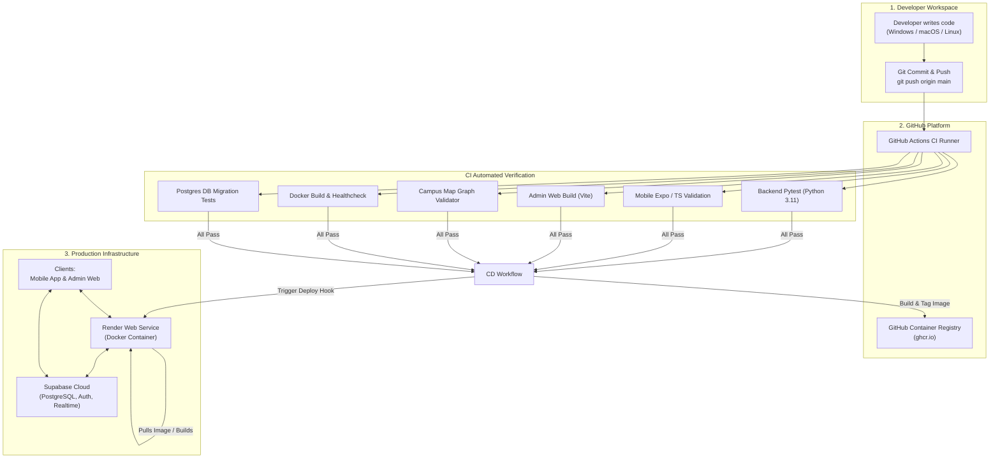
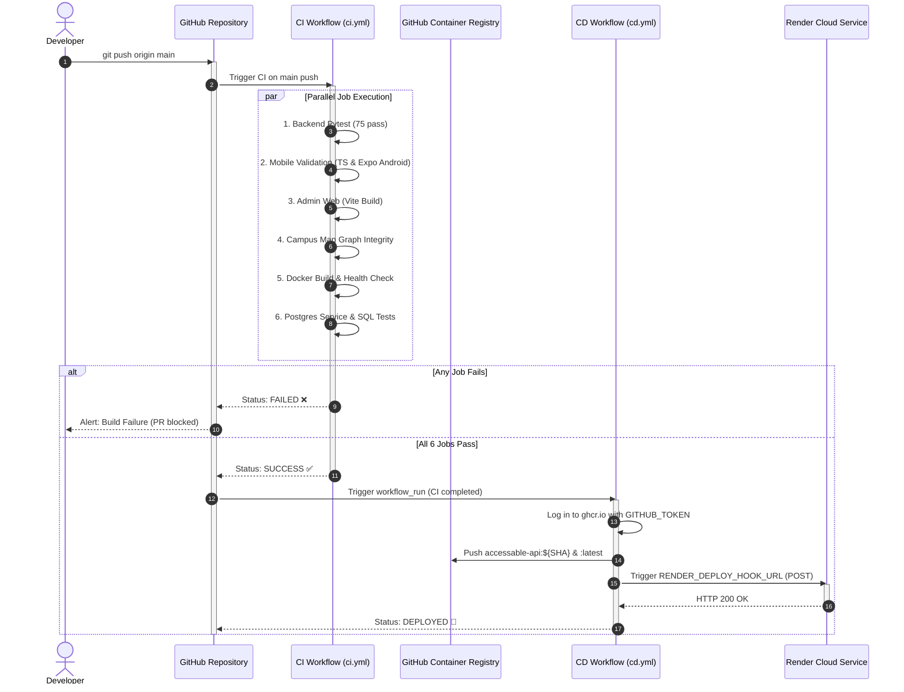

# Comprehensive Docker and CI/CD Guide for AccessAble AI

> **Target Audience:** Computer Science students and junior/intermediate software engineers who want to master containerization, modern DevOps, and automated delivery pipelines on real-world multi-tier architectures.  
> **System Focus:** AccessAble AI (FastAPI Backend, Supabase Database & Auth, React Native / Expo Mobile, Vite Admin Web, Render Hosting, GitHub Container Registry).

---

## Table of Contents
1. [Chapter 1: Understanding the Architecture](#chapter-1-understanding-the-architecture)
2. [Chapter 2: Docker Implementation](#chapter-2-docker-implementation)
3. [Chapter 3: Essential Docker Commands](#chapter-3-essential-docker-commands)
4. [Chapter 4: GitHub Actions Implementation](#chapter-4-github-actions-implementation)
5. [Chapter 5: CI/CD Pipeline Execution](#chapter-5-cicd-pipeline-execution)
6. [Chapter 6: GitHub Secrets and Environment Variables](#chapter-6-github-secrets-and-environment-variables)
7. [Chapter 7: How to Reproduce Everything Manually](#chapter-7-how-to-reproduce-everything-manually)
8. [Chapter 8: Troubleshooting & Real-World Debugging](#chapter-8-troubleshooting--real-world-debugging)
9. [Chapter 9: Interview Preparation (40 Questions & Model Answers)](#chapter-9-interview-preparation)
10. [Chapter 10: Final Revision Sheet](#chapter-10-final-revision-sheet)

---

## Chapter 1: Understanding the Architecture

### 1.1 What Docker Does
When writing code on a personal development computer (running Windows 11, macOS, or Ubuntu), the code depends on the specific Python version installed, system C-libraries, file path separators (`\` vs `/`), and local environment variables. When that application is transferred to a production cloud server, subtle differences cause the dreaded phrase: *"It works on my machine, why is it failing in production?"*

**Docker** solves this by packaging the software, runtime, system tools, libraries, and default configurations into a lightweight, standalone, executable package called an **Image**. When that image runs, it creates an isolated process environment called a **Container**. A container runs identically regardless of whether the host OS is Windows, Linux, or a cloud virtual machine.

### 1.2 What CI/CD Means
Software engineering in production requires speed without compromising safety.
- **Continuous Integration (CI):** The automated practice of building code, verifying dependencies, and executing test suites whenever a developer pushes commits or creates a Pull Request. CI prevents broken code, syntax errors, and regression bugs from merging into the `main` branch.
- **Continuous Deployment (CD):** The automated pipeline that takes verified code from the `main` branch, packages it into a production Docker image, pushes it to an image registry, and triggers the hosting infrastructure to deploy the update without manual human intervention.

### 1.3 Why AccessAble AI Needs Docker and CI/CD
AccessAble AI is an assistive navigation and vision platform for visually impaired students. It combines:
1. **Low latency routing algorithms:** Dijkstra / A* graph navigation algorithms over multi-floor campus layouts.
2. **AI Multimodal Vision & OCR:** Integration with Google Gemini Flash-Lite and OCR engines.
3. **Emergency Lifeline (SOS):** High-reliability database triggers and realtime channels in Supabase.
4. **Cross-platform Clients:** An Expo React Native mobile client and a Vite React administrative dashboard.

Without CI/CD, updating the Python backend could silently break campus map parsing, mobile bundle exports, or database RPC functions. Without Docker, deploying the FastAPI backend to Render would depend on Render's native Python buildpack matching the exact versions of C-extensions required by `Pillow`, `asyncpg`, and `cryptography`.

### 1.4 How Docker, GitHub Actions, Render, and Supabase Work Together
- **Supabase** acts as the managed PostgreSQL database, authentication server, and Realtime WebSocket hub.
- **GitHub Actions** acts as the automated quality assurance inspector. Every commit triggers automated runners that build the mobile app, build the web admin panel, run backend pytest suites, test PostgreSQL migrations, and build Docker containers.
- **GitHub Container Registry (GHCR)** stores versioned, immutable production Docker images tagged with the Git commit SHA.
- **Render** runs the containerized FastAPI web service in the cloud, dynamically binding the container to its public routing infrastructure.



---

## Chapter 2: Docker Implementation

### 2.1 Why We Created `services/api/Dockerfile`
Render supports native Python buildpacks, but Docker provides three indispensable advantages:
1. **Complete Parity:** The exact Debian base image, system libraries (`curl`, `glibc`), and Python 3.11 environment tested in CI are what run in production.
2. **Portability:** If Render changes pricing or policies, the same container can run on AWS ECS, Google Cloud Run, Azure Container Apps, or Kubernetes with zero code changes.
3. **Security:** Native buildpacks frequently execute as root. Our Dockerfile drops privileges to an unprivileged system user (`appuser`).

### 2.2 Line-by-Line Anatomy of the Production Dockerfile

```dockerfile
# 1. Base Image
FROM python:3.11-slim
```
* **Why `python:3.11-slim`?** The standard `python:3.11` image includes full GCC toolchains and man pages (~1GB). The `alpine` variant uses `musl libc`, which can cause compatibility and performance issues with pre-compiled Python wheels like `asyncpg`, `cryptography`, and `Pillow`. `slim` provides standard GNU `glibc` on Debian while keeping the download under 150MB.

```dockerfile
# 2. Environment Variables
ENV PYTHONDONTWRITEBYTECODE=1 \
    PYTHONUNBUFFERED=1 \
    PYTHONPATH=/app \
    PORT=8000
```
* `PYTHONDONTWRITEBYTECODE=1`: Prevents Python from writing `.pyc` files into container layers.
* `PYTHONUNBUFFERED=1`: Flushes standard output and standard error immediately so logs appear instantly in `docker logs` and Render without buffering delays.
* `PYTHONPATH=/app`: Enables modules inside `/app/app` to be imported as `import app.main` from any directory.
* `PORT=8000`: Provides a fallback port.

```dockerfile
# 3. Working Directory
WORKDIR /app
```
* Sets the container's execution root to `/app`. Any subsequent `COPY`, `RUN`, or `CMD` operates relative to this directory.

```dockerfile
# 4. System Package Installation
RUN apt-get update && apt-get install -y --no-install-recommends \
    curl \
    && rm -rf /var/lib/apt/lists/*
```
* Installs `curl` so Docker and Kubernetes can query the HTTP `/health` endpoint.
* `--no-install-recommends` prevents installing optional recommended packages.
* `rm -rf /var/lib/apt/lists/*` deletes the package index cache, saving ~35MB in the final image layer.

```dockerfile
# 5. Non-Root Security User
RUN groupadd -r appuser && useradd -r -g appuser -d /app -s /sbin/nologin -c "AccessAble App User" appuser
```
* Creates a dedicated system group and user (`appuser`) without login shell privileges.

```dockerfile
# 6. Dependency Caching Layer
COPY services/api/requirements.txt /app/requirements.txt
RUN pip install --no-cache-dir --upgrade pip && \
    pip install --no-cache-dir -r /app/requirements.txt
```
* **Why copy requirements before application code?** Docker caches layers from top to bottom. If you edit a Python file in `app/routers/campus.py`, Docker reuses the cached `pip install` layer and rebuilds the image in less than 2 seconds rather than re-downloading packages.

```dockerfile
# 7. Copy Application Code & Map Data
COPY services/api/app /app/app
COPY services/api/scripts /app/scripts
COPY data /app/data
```
* Copies the FastAPI source code, database seeding utilities, and the shared campus map JSON/PNG assets into the container.

```dockerfile
# 8. Ownership & User Switch
RUN chown -R appuser:appuser /app
USER appuser
```
* Assigns ownership of `/app` to `appuser` and drops root privileges.

```dockerfile
# 9. Health Check Instruction
HEALTHCHECK --interval=30s --timeout=5s --start-period=10s --retries=3 \
    CMD curl -f "http://127.0.0.1:${PORT:-8000}/health" || exit 1
```
* Tells Docker to periodically poll `/health`. If the server crashes or deadlocks, Docker flags the container status as `unhealthy`.

```dockerfile
# 10. Container Entrypoint
CMD ["sh", "-c", "exec uvicorn app.main:app --host 0.0.0.0 --port ${PORT:-8000}"]
```
* **Why `0.0.0.0`?** Binding to `127.0.0.1` binds exclusively to the container's internal loopback interface, making it unreachable from the host machine or Render router. Binding to `0.0.0.0` listens on all network interfaces.
* **Why `${PORT:-8000}`?** Render dynamically assigns a port (such as `10000`) through the `$PORT` environment variable. This shell substitution evaluates Render's `$PORT` while defaulting to `8000` locally.
* **Why `exec`?** `exec` replaces the shell process with `uvicorn` as Process ID 1 (PID 1). When Docker stops the container with `SIGTERM`, `uvicorn` receives the signal directly and cleanly drains existing HTTP connections.

### 2.3 Docker Compose (`docker-compose.yml`)
Docker Compose orchestrates multi-container applications and simplifies local development:

```yaml
services:
  api:
    build:
      context: .
      dockerfile: services/api/Dockerfile
    container_name: accessable-api
    restart: unless-stopped
    ports:
      - "${PORT:-8000}:8000"
    env_file:
      - path: services/api/.env
        required: false
      - path: .env
        required: false
    environment:
      - PORT=8000
      - ENV=${ENV:-development}
      - DEV_AUTH=${DEV_AUTH:-1}
      - CAMPUS_MAP_ENABLED=${CAMPUS_MAP_ENABLED:-1}
      - CAMPUS_MAP_PATH=${CAMPUS_MAP_PATH:-app/data/nie_north_campus.json}
      - MAP_SOURCE=${MAP_SOURCE:-db}
      - CORS_ORIGINS=${CORS_ORIGINS:-*}
    volumes:
      - ./services/api/app:/app/app:ro
      - ./data:/app/data:ro
    healthcheck:
      test: ["CMD-SHELL", "curl -f http://127.0.0.1:8000/health || exit 1"]
      interval: 15s
      timeout: 5s
      retries: 3
      start_period: 5s
```
Key features:
- **Build Context `.`:** Builds from repository root so `data/` and `services/api/` are both accessible.
- **Port Mapping `${PORT:-8000}:8000`:** Maps host port to container port 8000. If host port 8000 is occupied, setting `PORT=8001` automatically redirects traffic without modifying the compose file.
- **Volumes `:ro`:** Mounts the local `app` directory and `data` directory as read-only, allowing developers to inspect or test local changes instantly.
- **Fail-safe Environment:** Loads local `.env` if available, but supplies sensible development defaults so the container runs out-of-the-box.

### 2.4 Why `.dockerignore` Is Mandatory
Without a `.dockerignore` file, `docker build` sends the entire folder (including `node_modules`, `.git`, temporary caches, and secret files) to the Docker daemon:
1. **Security Risk:** If `.env` or `api.txt` is sent to the daemon and copied by `COPY . .`, secrets become permanently embedded in the image layers.
2. **Build Slowdown:** Transferring gigabytes of frontend `node_modules` and `.git` commits wastes time and memory.

Our `.dockerignore` strictly excludes `.git`, `.env*`, `api.txt`, `node_modules/`, `apps/`, `docs/`, and Python caches while allowing the required `services/api` and `data` directories.

---

## Chapter 3: Essential Docker Commands

| Command | Purpose in AccessAble AI | Expected Result |
|---|---|---|
| `docker --version` | Verify Docker CLI installation | `Docker version 29.8.2...` |
| `docker build -t accessable-api:local -f services/api/Dockerfile .` | Build the API Docker image using repository root as context | Multi-stage build output ending in `naming to ... done` |
| `docker images` | List locally stored container images | Table showing repository, tag, image ID, and size |
| `docker run -d --name test-api -p 8000:8000 accessable-api:local` | Run image in background with port 8000 exposed | Prints the 64-character container hash |
| `docker ps` | List active, running containers | Shows `accessable-api` with status `Up ... (healthy)` |
| `docker ps -a` | List all containers (running and stopped) | Shows exit codes and history of stopped containers |
| `docker logs accessable-api` | Inspect application console logs | Shows Uvicorn startup logs and incoming HTTP requests |
| `docker logs -f accessable-api` | Follow live stream of container logs | Real-time terminal streaming of application events |
| `docker exec -it accessable-api sh` | Open interactive shell inside container | `appuser@<hash>:/app$` command prompt |
| `docker exec accessable-api whoami` | Verify non-root execution | Prints `appuser` |
| `docker stop accessable-api` | Gracefully send `SIGTERM` to stop container | Prints container name after graceful drain |
| `docker rm accessable-api` | Delete stopped container instance | Deletes container filesystem state |
| `docker rmi accessable-api:local` | Remove image from local cache | Frees disk space occupied by layers |
| `docker compose up -d` | Build, create, and launch all services in background | `Container accessable-api Started` |
| `docker compose up --build -d` | Force rebuild of image and restart containers | Re-executes Dockerfile steps and updates container |
| `docker compose ps` | Check health and port bindings of compose services | Shows service `api` is `Up ... (healthy)` |
| `docker compose logs -f` | Stream consolidated logs from all compose services | Unified color-coded output from services |
| `docker compose down` | Stop containers, remove networks and teardown compose | `Container accessable-api Removed` |

---

## Chapter 4: GitHub Actions Implementation

### 4.1 Fundamentals of GitHub Actions
- **Workflow:** An automated end-to-end procedure defined in a `.github/workflows/<name>.yml` file.
- **Trigger (`on:`):** The event that starts the workflow (e.g., `push` to `main`, `pull_request`, or `workflow_dispatch` for manual runs).
- **Job:** A set of steps executed on an independent, fresh virtual machine (called a **Runner**). Jobs execute in parallel by default unless configured with `needs:`.
- **Step:** An individual task within a job, either executing a shell command (`run:`) or a reusable community action (`uses:`).
- **Runner:** An ephemeral virtual machine hosted in GitHub's cloud (e.g., `ubuntu-latest` has 2 vCPUs, 7GB RAM, pre-installed Docker, Python, Node, and Git).

### 4.2 Detailed Breakdown of `.github/workflows/ci.yml`

The CI workflow triggers on pushes and pull requests to `main`. It contains 6 independent jobs running concurrently on fresh Ubuntu runners:

#### Job 1: `backend-tests`
- Configures Python 3.11 with pip caching.
- Installs `services/api/requirements.txt` and `requirements-dev.txt`.
- Sets test environment variables (`ENV=test`, `DEV_AUTH=1`, `CAMPUS_MAP_ENABLED=1`).
- Executes `pytest -v` from `services/api`. Fails if any test regresses.

#### Job 2: `mobile-validation`
- Configures Node.js 20 with npm caching pinned to `apps/mobile/package-lock.json`.
- Executes reproducible dependency install: `npm ci`.
- Runs TypeScript validation: `npx tsc --noEmit`.
- Validates Metro bundler and Android assets export: `npx expo export --platform android`.

#### Job 3: `admin-web-validation`
- Configures Node.js 20 with npm caching pinned to `apps/admin-web/package-lock.json`.
- Executes `npm ci`.
- Runs `npm run build` (which executes `tsc --noEmit && vite build`), generating the production SPA bundle.

#### Job 4: `campus-map-validation`
- Sets up Python 3.11.
- Runs `python data/sample-campus/validate_map.py`.
- Checks graph integrity, step-free path calculations, QR checkpoint resolution, and searchable node counts.

#### Job 5: `docker-validation`
- Uses `docker/setup-buildx-action@v3`.
- Builds `services/api/Dockerfile` with repo root context without requiring production secrets.
- Launches the container locally on the runner with port `8000:8000`.
- Executes an active polling loop against `http://127.0.0.1:8000/health`.
- Validates that the container is running under unprivileged user `appuser`.
- Shuts down and cleans up the container.

#### Job 6: `database-validation`
- Provisions an ephemeral PostgreSQL 15 service container on the runner with automated `pg_isready` health checks.
- Installs `postgresql-client`.
- Runs `bash supabase/tests/run_tests.sh`.
- Applies all migrations (`0001_schema.sql` through `0004_realtime_storage.sql`), verifies Row-Level Security (RLS) policies, tests RPC emergency workflows, and tests `seed.sql` loading on a clean database.

### 4.3 Detailed Breakdown of `.github/workflows/cd.yml`

The CD workflow triggers automatically only after the CI workflow completes successfully on `main` (`workflow_run`), or manually via `workflow_dispatch`.

1. **Security Boundaries:**
   - Has `permissions: contents: read, packages: write`.
   - Never exposes deploy hooks or container tokens to pull requests.
2. **GHCR Publishing:**
   - Authenticates to `ghcr.io` using the built-in ephemeral `${{ secrets.GITHUB_TOKEN }}`.
   - Converts repository owner to lowercase to conform with Open Container Initiative (OCI) registry naming standards.
   - Builds and tags the production image with both the immutable Git SHA (`:${{ github.sha }}`) and `:latest`.
   - Utilizes GitHub Actions cache (`type=gha`) to dramatically accelerate re-builds.
3. **Render Deployment:**
   - Reads `RENDER_DEPLOY_HOOK_URL` from repository secrets.
   - If the secret is missing, it outputs an informative message explaining how to configure it without failing the build or falsely claiming deployment.
   - If configured, it triggers the Render zero-downtime deploy hook over HTTPS without logging the secret URL.

---

## Chapter 5: CI/CD Pipeline Execution



### What Happens If Any Job Fails?
- GitHub Actions immediately marks the commit status with a red `X`.
- Pull Requests targeting `main` are blocked from merging (when Branch Protection Rules are enabled).
- The CD pipeline is never triggered, ensuring broken code is never published to GHCR or deployed to Render.

---

## Chapter 6: GitHub Secrets and Environment Variables

### 6.1 Concepts
- **Environment Variables (`env`):** Configuration values passed to processes at runtime (e.g., `PORT=8000`, `ENV=development`). These are not sensitive and can be committed to repository configuration files.
- **GitHub Secrets:** Encrypted environment variables stored securely in GitHub. They are masked in runner logs (`***`) and decrypted only within executing runner memory.
- **Build-Time vs Runtime Variables:**
  - *Build-Time (`ARG` in Dockerfile):* Available only while building the image. Never put passwords or API keys in `ARG` because values can be inspected in the image metadata (`docker history`).
  - *Runtime (`ENV` in Docker / Render):* Injected into the container process when it starts. This is where API keys and database credentials belong.

### 6.2 Required Secrets for AccessAble AI

| Secret Name | Where to Obtain | Usage in Pipeline |
|---|---|---|
| `GITHUB_TOKEN` | Automatically generated by GitHub Actions | Used in CD to authenticate and push images to GHCR |
| `RENDER_DEPLOY_HOOK_URL` | Render Dashboard → API Service → Settings → Deploy Hook | Used in CD to trigger Render redeployment |
| `SUPABASE_URL` | Supabase Dashboard → Settings → API | Production API runtime connection |
| `DATABASE_URL` | Supabase Dashboard → Settings → Database (Session Pooler) | Production API direct PostgreSQL pooler |
| `GEMINI_API_KEY` | Google AI Studio | Production AI vision, OCR, and news briefings |
| `OCR_SPACE_API_KEY` | OCR.space free API key portal | Production sign-reading fallback |

> [!WARNING]
> **Credential Rotation Notice:** The repository root previously contained a local `api.txt` file. While this file is correctly ignored by `.gitignore` and has **never been committed to Git history**, any credentials stored in plaintext on disk should be rotated immediately before sharing repository access with external collaborators.

### 6.3 How to Add Secrets to Your GitHub Repository
1. Open your repository on GitHub.
2. Click **Settings** (gear icon) on the top menu.
3. In the left sidebar, navigate to **Secrets and variables** → **Actions**.
4. Click the green **New repository secret** button.
5. Enter the name (e.g., `RENDER_DEPLOY_HOOK_URL`) and paste the value.
6. Click **Add secret**.

---

## Chapter 7: How to Reproduce Everything Manually

If you create a new full-stack project tomorrow with a FastAPI backend and external clients, follow this exact step-by-step checklist:

### Step 1: Inspect the Project
Verify package dependencies, entrypoint files, and relative resource paths:
```bash
python -m pip list
ls services/api/
```

### Step 2: Create the Production Dockerfile
Create `services/api/Dockerfile`:
- Use `python:3.11-slim`.
- Set `WORKDIR /app`.
- Install `curl` for health checks.
- Create non-root system user `appuser`.
- Copy `requirements.txt` first and run `pip install --no-cache-dir`.
- Copy source code and assets.
- Switch to `USER appuser`.
- Add `HEALTHCHECK` pointing to `/health`.
- Set `CMD ["sh", "-c", "exec uvicorn app.main:app --host 0.0.0.0 --port ${PORT:-8000}"]`.

### Step 3: Create `.dockerignore`
Create `.dockerignore` at repository root. Exclude `.git`, `.env*`, `node_modules`, `dist`, caches, and client applications.

### Step 4: Create `docker-compose.yml`
Create root `docker-compose.yml` defining the service, port forwarding `${PORT:-8000}:8000`, volume mounts for dev, and healthchecks.

### Step 5: Test Docker Build and Run Locally
```bash
# Build image from repository root
docker build -t my-api:test -f services/api/Dockerfile .

# Run with Docker Compose
docker compose up -d

# Verify container health
docker compose ps

# Test the health endpoint
curl -i http://localhost:8000/health

# Clean up
docker compose down
```

### Step 6: Create GitHub Actions Workflows
Create `.github/workflows/ci.yml` and `.github/workflows/cd.yml`.
- Validate syntax locally before pushing:
```bash
python -c "import yaml; yaml.safe_load(open('.github/workflows/ci.yml')); yaml.safe_load(open('.github/workflows/cd.yml')); print('Valid!')"
```

### Step 7: Push and Verify
```bash
git add .
git commit -m "Implement production Docker and CI/CD pipelines"
git push origin main
```
Navigate to the **Actions** tab on your GitHub repository to watch the pipeline execute in real time.

---

## Chapter 8: Troubleshooting & Real-World Debugging

### 1. Docker Daemon Not Running
* **Symptom:** `error during connect: open //./pipe/dockerDesktopLinuxEngine: The system cannot find the file specified.`
* **Root Cause:** The Docker background service or Docker Desktop application is closed.
* **Fix:** Start Docker Desktop or start the service via PowerShell:
  `Start-Process "C:\Users\<user>\AppData\Local\Programs\DockerDesktop\Docker Desktop.exe"`

### 2. Port Already in Use (Real Bug Solved During Implementation!)
* **Symptom:** `driver failed programming external connectivity ... Bind for 0.0.0.0:8000 failed: port is already allocated`
* **Root Cause:** Another process or previous Docker container is already listening on host port 8000.
* **Fix:**
  1. Identify the occupying container or process: `docker ps` or `Get-NetTCPConnection -LocalPort 8000`.
  2. Stop the conflicting container: `docker stop <conflicting-container-name>`.
  3. Alternatively, override the host port in `.env` without modifying code: `PORT=8001 docker compose up -d`.

### 3. YAML Syntax Error: "Mapping values are not allowed here" (Real Bug Solved!)
* **Symptom:** GitHub Actions parser error or `yaml.scanner.ScannerError: mapping values are not allowed here in .github/workflows/ci.yml`.
* **Root Cause:** Writing a step name with a colon followed by a space without quotes, e.g., `- name: Build Docker image (context: root)`. In YAML, `: ` denotes a key-value mapping!
* **Fix:** Wrap the string in quotes: `- name: "Build Docker image (context: root)"`.

### 4. Container Exits Unexpectedly
* **Symptom:** Container starts and exits with code 1 or 137.
* **Fix:** Run `docker logs <container-name>` to view the stack trace. Common causes include missing environment variables or syntax errors in `main.py`.

### 5. Health Check Fails (`unhealthy`)
* **Symptom:** `docker ps` shows `Up (unhealthy)`.
* **Fix:**
  - Verify that `curl` is installed inside the image.
  - Verify that the app listens on `0.0.0.0` (not `127.0.0.1`).
  - Verify that the endpoint path matches (e.g. `/health`).
  - Increase `start-period` if the application takes longer to initialize.

### 6. Tests Fail in CI but Pass Locally
* **Symptom:** Pytest passes on developer machine but fails on `ubuntu-latest`.
* **Root Cause:** Hardcoded OS-specific path separators (`\` vs `/`), missing dependencies in `requirements.txt`, or relying on local untracked `.env` values.
* **Fix:** Always use Python's `pathlib.Path` and explicitly provide required test variables in the workflow `env:` block.

---

## Chapter 9: Interview Preparation

### Part A: 20 Docker Interview Questions & Model Answers

1. **What is the difference between a Docker Image and a Docker Container?**
   * *Answer:* An image is an immutable, read-only template with application code, libraries, and instructions. A container is a runnable, isolated runtime instance of an image with a thin read-write layer on top.
2. **Why is `python:3.11-slim` preferred over `alpine` for Python applications?**
   * *Answer:* Python wheels for packages with C-extensions (`Pillow`, `asyncpg`, `cryptography`) are compiled against standard GNU `glibc`. Alpine uses `musl libc`, forcing pip to compile from source (slowing builds) or leading to runtime memory bugs. `slim` provides standard `glibc` with minimal disk overhead.
3. **Why should we run containers as a non-root user?**
   * *Answer:* Defense in depth. If a security vulnerability (such as remote code execution) occurs in FastAPI or an installed library, running as an unprivileged user prevents the attacker from modifying container system files or escaping to the host kernel.
4. **Why do we copy `requirements.txt` before copying the rest of the application code?**
   * *Answer:* Docker builds images in cached layers. Application source code changes frequently, while dependencies change rarely. Placing `requirements.txt` and `pip install` earlier preserves the cached dependency layer, reducing build times from minutes to seconds.
5. **Why must a containerized web server bind to `0.0.0.0` instead of `127.0.0.1`?**
   * *Answer:* `127.0.0.1` is the loopback interface internal to the container. Binding to `127.0.0.1` makes the service unreachable to Docker's port bridge or external load balancers. `0.0.0.0` binds to all network interfaces.
6. **What is the difference between `CMD` and `ENTRYPOINT` in a Dockerfile?**
   * *Answer:* `ENTRYPOINT` defines the default executable that always runs, while `CMD` provides default arguments that can be overridden at runtime by the user when running `docker run`.
7. **Why use `exec uvicorn` inside the Docker `CMD` shell string?**
   * *Answer:* Without `exec`, the shell (`/bin/sh`) remains PID 1 and may swallow OS signals like `SIGTERM`. `exec` replaces the shell process with `uvicorn` as PID 1, allowing graceful shutdowns and connection draining when stopping containers.
8. **What does `.dockerignore` do, and what must be included?**
   * *Answer:* It prevents unnecessary or sensitive files from entering the Docker build context. It must include `.env*`, credentials, `.git`, `node_modules`, and temporary build/test caches.
9. **How does Docker Compose differ from Dockerfile?**
   * *Answer:* A Dockerfile defines how to build an individual image. Docker Compose is an orchestration tool used to define, configure, and connect multiple containers (networks, volumes, ports, environment variables) using a single YAML file.
10. **What is a Docker multi-stage build?**
    * *Answer:* A build pattern where intermediate containers compile binaries or assets, and only the finished artifacts are copied into the final minimal production image, discarding build tools to minimize image size.
11. **How do Docker healthchecks work?**
    * *Answer:* Docker periodically runs a command inside the container (e.g., `curl -f http://127.0.0.1:8000/health`). Based on exit code (0 for success, 1 for failure), Docker sets the container status to `healthy` or `unhealthy`.
12. **What happens when a container runs out of memory (OOM)?**
    * *Answer:* The Linux kernel OOM Killer terminates the process with exit code 137 (`SIGKILL`).
13. **What is a bind mount versus a named volume?**
    * *Answer:* A bind mount maps an exact host directory (e.g. `./services/api/app`) to a container directory, ideal for live development reloading. A named volume is managed entirely by Docker inside its storage engine, preferred for persistent production data.
14. **How do you reduce Docker image size?**
    * *Answer:* Use minimal base images (`slim`), combine `RUN` commands to minimize layers, avoid installing recommended packages (`--no-install-recommends`), clear package caches (`rm -rf /var/lib/apt/lists/*`), and exclude unwanted files with `.dockerignore`.
15. **What is the difference between the exec form and shell form in Dockerfile?**
    * *Answer:* Exec form `["executable", "param1"]` executes directly without a shell, avoiding shell signal issues. Shell form `executable param1` runs inside `/bin/sh -c`, enabling environment variable evaluation like `${PORT}`.
16. **Why shouldn't you commit `.env` into a Docker image?**
    * *Answer:* Docker image layers are immutable and easily inspected with `docker history` or extraction tools. Anyone with access to the image can extract the secret keys.
17. **What is the purpose of `EXPOSE 8000`?**
    * *Answer:* It is documentation metadata indicating which port the service listens on. It does not actually publish the port; publishing requires `-p` or compose `ports:`.
18. **How does Docker handle container networking?**
    * *Answer:* Docker creates virtual bridge networks. Containers attached to the same user-defined bridge network can communicate with each other using container names as DNS hostnames.
19. **How did we configure dynamic port handling for Render?**
    * *Answer:* By using `sh -c "exec uvicorn app.main:app --host 0.0.0.0 --port ${PORT:-8000}"`, allowing the container to dynamically read Render's injected `$PORT` environment variable while falling back to 8000.
20. **How can you inspect files inside a running container?**
    * *Answer:* Using `docker exec -it <container_name> sh` to open an interactive terminal, or `docker cp` to copy files between the container and host.

---

### Part B: 20 CI/CD & GitHub Actions Interview Questions & Model Answers

1. **What is the difference between Continuous Integration and Continuous Deployment?**
   * *Answer:* CI automatically validates, builds, and tests code on every commit. CD automatically packages and deploys the verified artifacts to staging or production environments upon successful CI.
2. **What is a GitHub Actions Runner?**
   * *Answer:* A virtual machine or container provisioned to execute jobs in a workflow. GitHub provides managed runners (`ubuntu-latest`, `windows-latest`, `macos-latest`), or teams can host self-hosted runners.
3. **What is the difference between `GITHUB_TOKEN` and a Personal Access Token (PAT)?**
   * *Answer:* `GITHUB_TOKEN` is an automatically provisioned, short-lived token scoped exclusively to the repository and specific workflow run. A PAT is tied to a user account and lasts until expiration.
4. **How do you ensure Pull Requests cannot compromise production secrets?**
   * *Answer:* Run CI on `pull_request` with read-only permissions (`contents: read`). Pull requests from forks do not have access to repository secrets by default in GitHub Actions.
5. **Why do we pin GitHub Actions (e.g. `actions/checkout@v4`)?**
   * *Answer:* Pinning to major versions or commit SHAs protects pipelines from breaking changes or supply-chain tampering if an upstream action repository is compromised.
6. **How does dependency caching work in GitHub Actions?**
   * *Answer:* `actions/setup-python` and `actions/setup-node` calculate a cryptographic hash of lockfiles (`package-lock.json`, `requirements.txt`). If the hash matches a previous run, dependencies are restored from cache in seconds rather than downloaded over the network.
7. **What is `workflow_run` and why did we use it for CD?**
   * *Answer:* `workflow_run` allows one workflow to trigger only after another workflow completes. We used it so CD runs only after CI successfully finishes on `main`.
8. **What does `concurrency: cancel-in-progress: true` do?**
   * *Answer:* If a developer pushes three commits in rapid succession, GitHub Actions automatically cancels the obsolete running builds for earlier commits, saving runner minutes and preventing race conditions.
9. **How do Service Containers work in GitHub Actions?**
   * *Answer:* They spin up Docker containers (such as PostgreSQL) alongside the runner job on the same virtual network, allowing tests to interact with real database engines without mock limitations.
10. **How did we test database migrations in CI without affecting Supabase production?**
    * *Answer:* We configured an isolated, ephemeral `postgres:15` service container inside GitHub Actions, loaded Supabase RPC stubs, applied migrations, ran all 8 SQL test suites, and validated seed data in pure isolation.
11. **Why shouldn't secrets be printed in workflow step logs?**
    * *Answer:* Workflow logs are permanently recorded and often visible to all repository collaborators. Printing secrets exposes them to unauthorized viewing.
12. **How does GitHub Actions handle secret masking?**
    * *Answer:* Any secret defined in GitHub Secrets is automatically intercepted in the runner output stream and replaced with `***`.
13. **What is the difference between `npm install` and `npm ci` in CI pipelines?**
    * *Answer:* `npm install` can update `package-lock.json` and install minor/patch updates. `npm ci` strictly installs the exact versions recorded in `package-lock.json`, deletes existing `node_modules`, and fails if the lockfile is out of sync, ensuring 100% reproducible builds.
14. **Why is tagging Docker images with the Git commit SHA better than just `:latest`?**
    * *Answer:* `:latest` is mutable and changes with every build, making rollbacks difficult and auditing impossible. The Git commit SHA provides an immutable, one-to-one link between the container artifact and the exact source code commit.
15. **What is GitHub Container Registry (GHCR)?**
    * *Answer:* GitHub's OCI-compliant package registry (`ghcr.io`) that hosts Docker container images directly integrated with repository permissions.
16. **Why must GHCR image repository names be lowercase?**
    * *Answer:* The Docker and OCI registry distribution specifications enforce strictly lowercase alphanumeric names for image tags and repositories.
17. **What is a Deploy Hook in Render?**
    * *Answer:* A unique, secret HTTPS webhook URL provided by Render. When triggered via an HTTP POST request, Render initiates a zero-downtime rolling redeployment of the web service.
18. **How do you handle missing secrets gracefully in CI/CD without false passes?**
    * *Answer:* Write conditional shell checks that inspect whether the environment variable is empty. If empty, print an explicit warning explaining what secret is required and explicitly state that deployment was skipped.
19. **What is the purpose of `timeout-minutes` in GitHub Actions jobs?**
    * *Answer:* It prevents hanging processes (such as frozen tests or deadlocked network requests) from consuming runner minutes indefinitely until the 6-hour default limit.
20. **How does the AccessAble AI mobile validation step work in CI?**
    * *Answer:* It executes TypeScript type-checking (`tsc --noEmit`) to verify React Native component types, then executes `npx expo export --platform android` to verify that Metro bundler can bundle all JavaScript, icons, and audio assets without bundling errors.

---

## Chapter 10: Final Revision Sheet

### High-Yield Concept Summary
- **Dockerfile:** Recipe for building an immutable image.
- **Image:** Built binary package containing application, dependencies, and OS libraries.
- **Container:** Running process isolated from host OS.
- **Docker Compose:** Multi-container local orchestration tool.
- **CI (Continuous Integration):** Test & validate on every PR/push.
- **CD (Continuous Deployment):** Package & deploy verified code automatically.
- **GHCR:** GitHub Container Registry for storing images.
- **Render Webhook:** Triggers automated production deployment on Render.

### Crucial File Map
- `services/api/Dockerfile`: Python 3.11-slim, non-root `appuser`, healthcheck, dynamic `$PORT`.
- `docker-compose.yml`: Root compose configuration, port forwarding `${PORT:-8000}:8000`, volume mounts.
- `.dockerignore`: Root exclusions (secrets, node_modules, .git, caches).
- `.env.example`: Safe placeholder template for local development.
- `.github/workflows/ci.yml`: 6 parallel verification jobs (Backend, Mobile, Admin Web, Campus Map, Docker, Database).
- `.github/workflows/cd.yml`: GHCR image publication & Render deployment.
- `render.yaml`: Infrastructure-as-Code blueprint for Render Docker web service.

### Essential Commands
```bash
# Build & run locally
docker compose up -d --build
docker compose ps
curl http://localhost:8000/health
docker compose down

# Run backend tests
cd services/api && pytest -q

# Run frontend checks
cd apps/mobile && npx tsc --noEmit && npx expo export --platform android
cd apps/admin-web && npm run build
python data/sample-campus/validate_map.py
```

### Golden Rules of DevOps
1. **Never commit secrets.** Always use `.gitignore`, `.dockerignore`, and GitHub Secrets.
2. **Never deploy unverified code.** CD must strictly depend on successful CI.
3. **Pin your versions.** Base images, GitHub Actions, and dependencies should have deterministic versions.
4. **Test in production-like isolation.** Run tests in clean containers or runners, not just your personal desktop.
